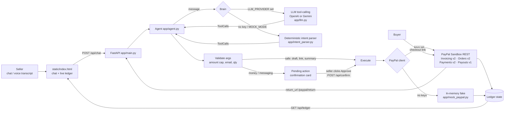

# AgentPay: talk to your PayPal

AgentPay is an AI agent for small sellers and freelancers. You type (or dictate) what you want in plain language:

> "Invoice Priya $40 for logo design, due Friday"
> "Make a checkout link for 2 T-shirts at $15"
> "Who hasn't paid?"
> "Refund the last order"

The agent turns that into PayPal API calls (Invoicing, Orders, Payments, Payouts) and runs them against the PayPal sandbox. **Anything that moves money or messages a customer waits for you to approve it.** The agent drafts and the seller decides. That's human-in-the-loop agentic commerce.

Built for the PayPal AI Hackathon (Devpost).

---

## What it does

| You say | Agent picks | PayPal API | Needs your click? |
|---|---|---|---|
| "Invoice Priya $40 for logo design, due Friday" | `create_invoice` → `send_invoice` | Invoicing v2: create draft, then send | Draft: no. **Send: yes** |
| "Invoice Meera (meera@…) $60 and Kabir (kabir@…) $35 for the workshop" | one `create_invoice` per person, as a plan | Invoicing v2, one draft + send per recipient | Drafts: no. **Each send: yes** (or approve the whole plan) |
| "Make a checkout link for 2 T-shirts at $15" | `create_checkout_link` | Orders v2: create order, return the buyer approval link | No (the buyer approves on PayPal) |
| *(buyer pays)* | auto-capture on return | Orders v2: capture | No (the buyer already approved) |
| "Refund $5 of order …" / "Refund the last order" | `refund_order` | Payments v2: refund a capture (partial or full) | **Yes** |
| "Who hasn't paid?" | `unpaid_summary` | Invoicing v2: list, plus local order state | No (read-only) |
| "Remind Priya" / "Remind everyone" | `remind_invoice` | Invoicing v2: remind | **Yes** |
| "Cancel Arjun's invoice" | `cancel_invoice` | Invoicing v2: cancel | **Yes** |
| "Pay $20 to alex@… and $10 to sam@…" | `create_payout` | Payouts v1: batch payout | **Yes** |
| "List paid invoices" | `list_invoices` | Invoicing v2: list | No |

The UI has a chat pane, with a mic button that uses the browser's speech recognition, and a live **ledger** side panel showing invoices, checkout orders, items waiting for approval, and an activity log.

## Architecture



### How the AI is used
- The tool catalogue (`app/tools.py`) is a set of JSON-schema function definitions. With `LLM_PROVIDER=openai` or `gemini`, the seller's message, today's date, and recent chat history go to the model with these tools. The model returns tool calls with arguments: who, how much, what currency, the due date resolved from "Friday", the items and quantities, and so on.
- The LLM only **proposes**. `app/agent.py` validates every argument server-side and resolves references like "Priya", "Arjun's invoice", or "the last order" to concrete PayPal IDs. Money-moving tools are never executed directly: they become a one-time confirmation card, and the action runs only when `POST /api/confirm` arrives with that card's ID.
- If the LLM call fails because of network, quota, or a bad response, the agent falls back to the deterministic parser and says so in the chat.
- Without any LLM key, the rule-based parser produces the same tool calls for the supported phrasings, so the demo is reproducible.

### How PayPal is used
`app/paypal_client.py` is a small REST client over `httpx` with no SDK:
- OAuth2 client-credentials token, cached until expiry.
- `PayPal-Request-Id` idempotency keys on create/send/capture/refund calls.
- Invoicing v2: `POST /v2/invoicing/invoices` (draft), `/send`, `/remind`, `/cancel`, and `GET` list/detail. Invoices without a customer email are sent with `send_to_recipient=false`, and the agent shows PayPal's shareable pay link (useful for sharing on WhatsApp).
- Orders v2: `POST /v2/checkout/orders` with intent `CAPTURE` and an item breakdown. The buyer link comes from the `payer-action` / `approve` link. When the buyer returns to `/paypal/return?token=…`, the app captures automatically.
- Payments v2: `POST /v2/payments/captures/{id}/refund`, full or partial. The agent checks the refundable balance first.
- Payouts v1: `POST /v1/payments/payouts` for splitting money with collaborators.

### Mock mode (zero credentials)
If PayPal keys are missing, or `MOCK_MODE=1` is set, the app uses `app/mock_paypal.py`. This in-memory fake has the same methods and status lifecycles as the real client (DRAFT → SENT → PAID/CANCELLED, CREATED → APPROVED → COMPLETED) and enforces the same rules, so you can't refund more than was captured or remind on a draft. Checkout and invoice links open **simulated buyer pages** under `/mock/…` with a "Pay now (simulated)" button, so judges can run the whole payment loop locally. Each of these pages is clearly labelled as a simulation.

## Run it

Requires Python 3.10+ (developed on 3.12).

```bash
cd paypal-agentpay
python -m venv .venv && source .venv/bin/activate      # Windows: .venv\Scripts\activate
pip install -r requirements.txt
cp .env.example .env                                    # optional; leave keys empty for mock mode
uvicorn app.main:app --reload --port 8000
```
Open http://localhost:8000. The badge in the header shows the active mode: `MOCK PayPal · rule-based parser` with no keys.

**Force mock mode** even when keys are present:
```bash
MOCK_MODE=1 uvicorn app.main:app --port 8000            # Windows PowerShell: $env:MOCK_MODE=1; uvicorn app.main:app
```

**Real PayPal sandbox + LLM**: edit `.env`:
```
PAYPAL_CLIENT_ID=...        # developer.paypal.com > Apps & Credentials > Sandbox
PAYPAL_CLIENT_SECRET=...
PAYPAL_ENV=sandbox
LLM_PROVIDER=openai         # or gemini
OPENAI_API_KEY=...          # or GEMINI_API_KEY=...
PUBLIC_BASE_URL=http://localhost:8000
```
Pay for checkout links with a sandbox *personal* (buyer) account from the PayPal developer dashboard. Invoices are created on the sandbox *business* account that owns the app credentials.

**Docker**
```bash
docker build -t agentpay .
docker run -p 8000:8000 agentpay                        # mock mode
docker run -p 8000:8000 --env-file .env agentpay        # with your keys
```

**Tests** (no network or keys needed; all HTTP is mocked):
```bash
pytest -q
```
- `tests/test_intent_parser.py`: commands → tool calls, amounts and currencies, due-date resolution.
- `tests/test_paypal_client.py`: request shapes, auth/token caching, idempotency headers, response normalization, and error handling against `httpx.MockTransport`.
- `tests/test_llm.py`: OpenAI and Gemini tool-call parsing against mocked responses.
- `tests/test_agent_flows.py`: end-to-end API flows in mock mode, including invoice→approve→send, checkout→pay→partial and full refund, the unpaid summary with overdue flags, remind-all, cancel, payout, decline, the safety cap, and the LLM fallback.

**Smoke scripts** against a running server:
- `./scripts/smoke_mock.sh http://127.0.0.1:8000`: the full loop in mock mode, including simulated buyer payment and refunds.
- `./scripts/smoke_sandbox.sh http://127.0.0.1:8000`: the live flows against a server started with real **sandbox** keys. It approves its own cards through the API, so it really creates, sends, reminds and cancels sandbox invoices, using fake `name.demo@example.com` recipients. It refuses to run against `PAYPAL_ENV=live` or a mock server (`SMOKE_ALLOW_MOCK=1` dry-runs it in mock mode). Payout and INR steps are reported as `EXPECTED-BY-COUNTRY` rather than failures when the account's country blocks them.

## Try these in the demo
1. `Invoice Priya $40 for logo design, due Friday` → **Approve**
2. `Invoice Arjun (arjun@example.com) ₹2,500 for website fixes, due 2026-11-01` → **Approve**
3. `Make a checkout link for 2 T-shirts at $15` → open the link → **Pay now (simulated)**
4. `Refund $5 of order <id>` → **Approve**, then `Refund the last order`
5. `Who hasn't paid?` → `Remind everyone unpaid` → **Approve**
6. `Cancel Arjun's invoice`, then `Pay $20 to alex@example.com and $10 to sam@example.com`

## Safety design
- Money-moving and customer-messaging actions require an explicit click on a single-use confirmation ID that is held server-side. The model can't approve its own actions.
- A server-side cap (`MAX_AMOUNT`, default 10000) applies to every amount, checked on top of whatever the model produced.
- Strict validation of emails, currency codes, quantities, and dates. The agent refuses unpaid-order refunds, over-refunds, and reminders on drafts or paid invoices.
- No secrets in code. Configuration comes only from environment variables or `.env`, which is git-ignored.
- `PAYPAL_ENV` defaults to `sandbox`.

## Limitations / known gaps
- No seller authentication in the UI. It is meant for local demo use only.
- The rule-based parser handles the phrasings above and a few variants. Free-form requests need an LLM key.
- Refunds for *invoice* payments are not wired up. Refunds cover checkout orders (captures).
- Refunds of a *real* sandbox checkout need a buyer to pay the link with a sandbox personal account first. Capture and refund are covered by mocked-HTTP tests and mock mode, not yet by a live run.

## What has been verified against the live PayPal sandbox
Run with real sandbox REST credentials (an India-registered sandbox business account), November 2026:

| Flow | Live result |
|---|---|
| Invoicing v2: create draft + send (with and without a customer email) | ✅ works |
| Invoicing v2: list / "Who hasn't paid?" summary | ✅ works |
| Invoicing v2: remind | ✅ works |
| Invoicing v2: cancel | ✅ works |
| Orders v2: checkout link (`payer-action` URL, total shown) | ✅ works |
| Orders v2: capture after buyer approval, Payments v2: refund | ⏳ not yet run live (needs a sandbox buyer to pay) |
| Payouts v1 | ❌ blocked by PayPal for India-registered merchants ("You live in a country that is not allowed to send this payout"). The agent now explains this in plain words. Use a **US** sandbox business account's credentials to demo payouts; the payout code is unchanged. |
| INR invoices to Indian buyers | ❌ blocked by PayPal for India-registered merchants (`INR_FOREIGN_CURRENCY_BLOCKED`); also explained in plain words. Invoice international customers in USD, or use a non-India sandbox account. |

What depends on the account's country: **payouts** and **INR** (and which currencies the account can receive in general). Everything else above worked on the India sandbox account. PayPal's own error text is always shown after the friendly explanation, so nothing is hidden.

## Built during the hackathon
All code in this repository was written during the PayPal AI Hackathon submission period (November 2026) for this submission. It uses open-source libraries (FastAPI, httpx, Pydantic, Uvicorn, pytest) and public PayPal, OpenAI, and Google Gemini REST APIs.

## License
MIT. See [LICENSE](LICENSE). © 2026 Rahul S R.
